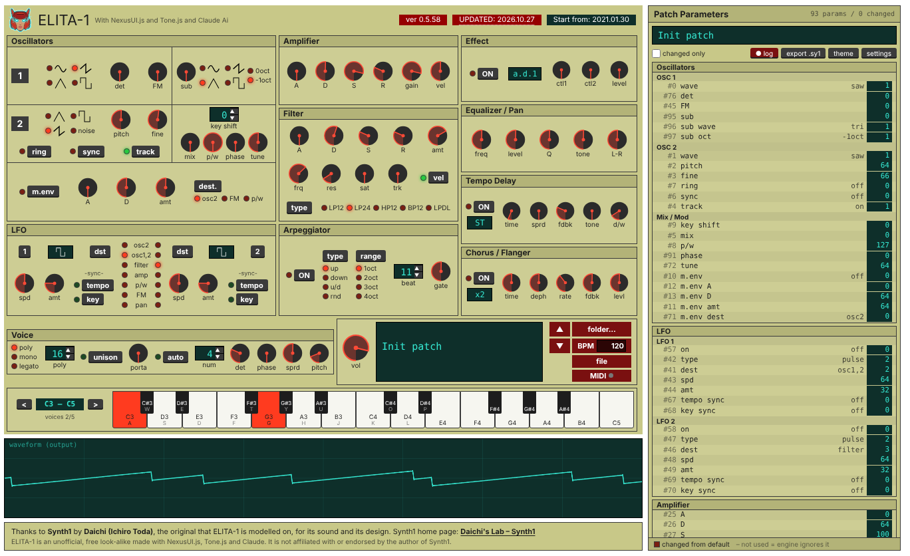
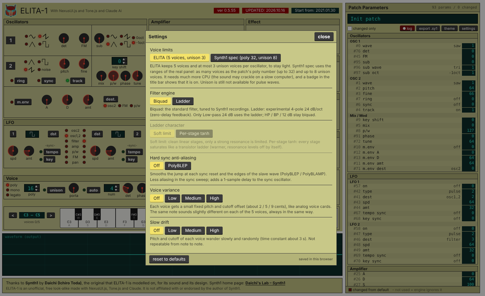
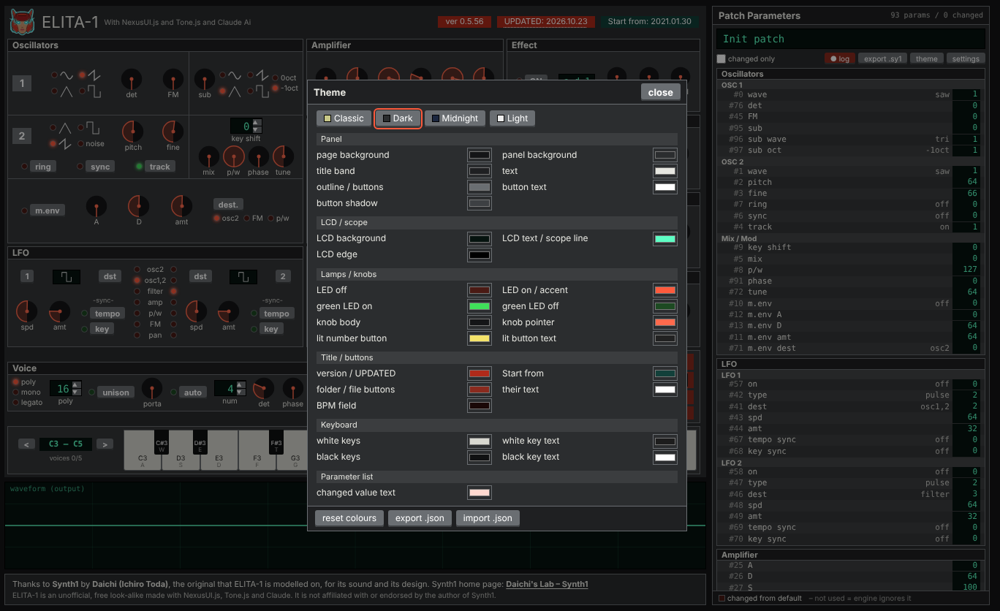
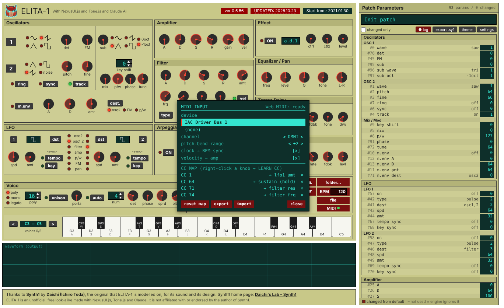
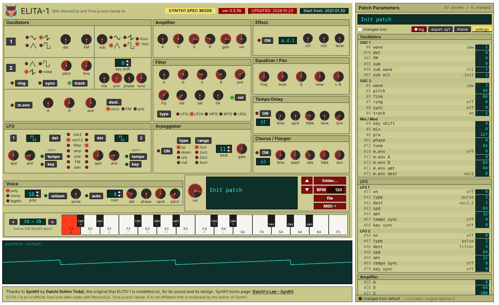
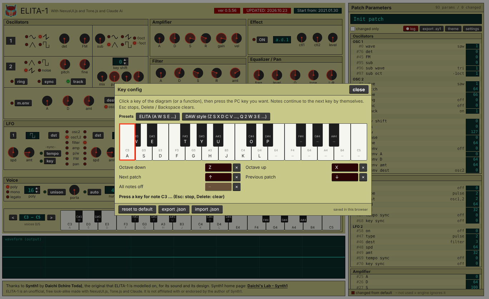

# ELITA-1

**日本語** | [English](README.en.md)

Synth1 のパッチ（`.sy1`）をブラウザで試聴するための、フリーのシンセサイザー。
画面は NexusUI.js、音は Tone.js（Web Audio）で作っています。

> **Synth1 の再現ではありません。** 内部構成（OSC → Filter → Amp、LFO、Mod Envelope、各エフェクト）は Synth1 に合わせていますが、各つまみの値と音色の対応は推測を含み、Synth1 と同じ音にはなりません。パッチの「だいたいの傾向」を聴くためのものです。
> 本プロジェクトは Synth1 の作者・配布元とは無関係の非公式プロジェクトです。

現在のバージョン: **ver 0.5.60**（更新内容は [history.md](history.md)、英語版は [history.en.md](history.en.md)）



| Settings | テーマ | MIDI 入力 |
| --- | --- | --- |
|  |  |  |

Settings の「Voice limits」を「Synth1 spec」にすると、タイトルバーに黄色の「SYNTH1 SPEC MODE」が出ます（下の画像）。



Settings の「Key config…」で、PC キーの割り当てを変えられます（下の画像）。




## 特長

- Synth1 風の画面（Oscillators / LFO / Amplifier / Filter / Arpeggiator / Effect / EQ・Pan / Tempo Delay / Chorus / Voice）。MIDI 部は省略したコンパクト版
- 5 ボイス・ポリフォニック（mono / legato、portamento、unison に対応。unison は 1 オシレーターあたり最大 3 本に制限）
- `.sy1` パッチの読み込み（1 ファイル、またはフォルダを指定して ↑↓ キーで切り替え）
- 画面下の鍵盤と PC キーボードで演奏（オクターブ切替あり）。外部の MIDI 機器やシーケンサーからも演奏可能（MIDI 入力、CC ラーン、クロック同期）
- 出力波形のオシロスコープ表示
- **Settings**: Voice limits（ELITA / Synth1 spec）、フィルター方式（Biquad / Ladder）、ハードシンクのアンチエイリアス（PolyBLEP）、ボイスごとの個体差とドリフトを選べます（下の「仕組み」を参照）
- **テーマ**: 配色 4 種と、色ごとの編集・書き出し・読み込み
- **MIDI 入力**（CC ラーン、MIDI クロックで BPM 同期）、セッションログ、`.sy1` の書き出し
- 画面上部の「UPDATED」をクリックすると、`history.md` の最新の更新内容が見られます（`show all` で全履歴）。
- 画面右側に、パッチの全パラメーターを文字で一覧表示（変更した項目を強調、`changed only` で絞り込み）。**値の欄は入力欄になっていて、数字を打って Enter（または欄の外をクリック）で、そのパラメーターを変更できます**。↑↓ で ±1（Shift で ±8）、Esc で取り消し。範囲外の数字は範囲内に丸め、入力できるのは数字だけです（文字や記号は入りません。マイナス記号は key shift のみ）。つまみや音にもすぐ反映されます
- コンソールで音の経路を確認できるデバッグモード

## 使い方

### 起動

ビルドは不要です。ただし `file://` で直接開くとブラウザによっては制限があるため、簡易サーバー経由を推奨します。

```bash
cd elita1
python3 -m http.server 8000
# ブラウザで http://localhost:8000/index.html を開く
```

Tone.js と NexusUI は `js/` に同梱しているので、ネットワーク接続なしで動きます。

画面内を一度クリックするか鍵盤を押すと、オーディオが始まります（ブラウザの自動再生規制のため）。

### 演奏

| 操作 | 内容 |
| --- | --- |
| 画面下の鍵盤をクリック | 発音 |
| `A W S E D F T G Y H U J K O L P` | 鍵盤（C から 1 オクターブ半。既定。変更できます） |
| `Z` / `X`（または `<` `>` ボタン） | オクターブ下げる / 上げる（C3〜C5 の表記が切り替わります） |
| `↑` / `↓` | 次 / 前のパッチ |

キー割り当ては Settings の「Key config…」で変更できます（次の節）。設定や他のウィンドウが開いているあいだは、PC キーで音は鳴りません。

### パッチの読み込み

- `file` ボタン、または `.sy1` ファイルのドラッグ＆ドロップで 1 つ読み込み
- `folder…` ボタンで `.sy1` の入ったフォルダを指定（直下のみ、名前順）

フォルダ指定後のキー操作:

| キー | 動作 |
| --- | --- |
| `↑` | 次のパッチ |
| `↓` | 前のパッチ |

端まで行くと反対側に回り込みます。画面の ▲▼ ボタンも同じ向きです（▲ が次、▼ が前）。
Chrome / Edge ではフォルダ選択ダイアログ、Firefox / Safari ではフォルダのアップロード画面になります。ページを再読み込みするとフォルダ指定はやり直しです。

### パッチの書き出し（エクスポート）

右側 Patch Parameters の `export .sy1` ボタンで、今のパネルの状態を Synth1 の `.sy1` ファイルとして保存できます（名前を聞かれ、`名前.sy1` としてダウンロードされます）。

- 形式は Synth1 のファイルと同じ（改行は CRLF、番号順はファクトリーパッチと同じ並び）。`ver=113` で、#0〜#98 を書き出します。
- ver 105 以下のパッチ（ファクトリーはすべて該当）は、読み込み時に実機 Synth1 が読み込み後に表示する値へ変換します（`#21`、`#37`、`#16` / `#18` / `#26` / `#28`、`#54`、`#55`。詳しくは history.md の 0.5.59）。そのため、書き出しは実機が保存する値と一致します。ver 106〜112 は変換しません（実機の挙動が未確認）。
- 読み込んだパッチにあって画面にないもの（`#40`, `#50`, `#51`, `#86`〜`#89`）は、そのまま書き戻します。
- パッチ名とファイル名は ASCII のみです（日本語などは `_` になります）。Synth1 が名前を OS の文字コードで読むためです。
- ファクトリー 128 音色を「読み込み → 書き出し」して、値がすべて一致することを確認しています。ただし、書き出したファイルを本物の Synth1 で読み込む確認は、まだできていません。

### MML（アイコンのジングルと、コンソールからの演奏）

画面左上のアイコン（`e1.png`）をクリックすると、今のパネルの音（読み込んだパッチ）で、短いジングルが MML で鳴ります。
将来 MML で ELITA-1 を駆動するための土台として、`ELITA.mml` を用意しています（`js/mml.js`）。

```js
ELITA.mml.play("t120 o4 l8 cdefgab>c")   // 演奏（もう一度呼ぶと、前の演奏を止めて最初から）
ELITA.mml.stop()                          // 停止
ELITA.mml.parse(text)                     // 音は出さず {events, duration, warnings} を返す
```

| 書き方 | 意味 |
| --- | --- |
| `c d e f g a b` | 音符。`+` / `#` で半音上、`-` で半音下。続けて長さ（4 = 4 分、8 = 8 分…）と付点 例: `c+8.` `e-4` |
| `r` | 休符 |
| `&` | タイ。同じ高さの次の音につなぐ 例: `c4&c8` |
| `l8` | 既定の長さ |
| `o4` | オクターブ（`o4 c` = 中央のド = MIDI 60）。`>` で 1 つ上、`<` で 1 つ下 |
| `t120` | テンポ（既定は BPM 欄の値） |
| `v12` | ベロシティ 0〜15（既定 12 = 0.8） |
| `q6` | ゲート 1〜8（8 = 音の長さいっぱい、既定 8） |
| `'ceg'4` | 和音（全部同時、長さは 1 つ） |
| `[ ... ]3` | くり返し（数字なしは 2 回） |
| `;` | トラックの区切り（同時に鳴らす） |
| `//` | 行末までコメント |

音は `engine.rawOn` / `rawOff` で鳴らすので、Arpeggiator がオンでも、MML の音は分解されません。ボイスは 5 つなので、同時に 5 音を超えると古い音から切れます。和音のタイは未対応です。

### つまみの操作

- ドラッグ（上下）で値を変更、マウスホイールで ±1（Shift で ±8）
- ダブルクリックで既定値に戻す
- 画面下のパッチ表示（LCD）をクリックすると、選択中のフォルダ内のパッチを一覧から直接選べます（フォルダ未選択のときはフォルダ選択）。↑↓ で移動、Enter で決定、Esc で閉じる
- LCD 風のボタンは、クリックで次へ、右クリックで前へ、ホイールでも切り替え。Effect / Delay / Chorus の type はクリックすると選択リストが開き、直接選べます（右クリックとホイールは従来どおり 1 つずつ）

### デバッグモード

`index.html?debug` で開くか、コンソールで `ELITA.debug.on()` を実行します（`ELITA.debug.off()` で終了）。

| コマンド | 内容 |
| --- | --- |
| `ELITA.debug.graph()` | 全体の信号経路（ボイスごとの状態、エフェクト段の ON/OFF と値、LFO の行き先） |
| `ELITA.debug.voice(i)` | i 番ボイスの内訳（OSC1/2、Sub、Noise、Ring、Sync、FM の音量など） |
| `ELITA.debug.meters()` | 各段の音量（dB）。音を鳴らしながら実行 |
| `ELITA.debug.params()` | 既定値から変更された項目と、エンジンが使っているか |
| `ELITA.debug.unused()` | エンジンが読んでいないパラメータの一覧 |

デバッグ中は、鍵盤を押すたびに「どのボイスで、どの経路を通って鳴っているか」、つまみを動かすたびに「どの番号が何から何に変わったか」がコンソールに出ます。

### MIDI 入力（別のアプリやタブのシーケンサーから演奏）

パッチ表示の右にある「MIDI ●」を押すと設定パネルが開きます（Chrome / Edge のみ。Safari は Web MIDI 非対応）。初回は MIDI 利用の許可が求められます。

- **device**: MIDI 入力デバイスを選びます。別タブのシーケンサー（Web アプリ）から鳴らすには、仮想 MIDI ポート（macOS は「IAC ドライバ」、Windows は loopMIDI など）を作り、シーケンサーの出力と ELITA-1 の入力に同じポートを指定します。
- **channel**: OMNI または 1〜16。**pitch-bend range**: ±1〜±24 半音。**velocity → amp**: ベロシティを音量に反映。
- 受信するもの: ノート、ベロシティ、ピッチベンド、CC（下記）、CC120 / CC123（全ノートオフ）、MIDI クロック。
- **CC MAP**: 初期値は CC1 → LFO1 amt、CC74 → filter frq、CC71 → filter res、CC64 → サステイン。つまみを右クリック →「LEARN CC…」を選び、MIDI 機器の CC を動かすと割り当てられます（Esc で中止）。reset / export / import ができます。設定と割り当てはこのブラウザに保存されます。
- **clock → BPM sync**: MIDI クロック（24 ppqn）から BPM を算出して BPM 欄に反映します（整数に丸めます）。
- 画面左下に受信状況（デバイス、最後のメッセージ、クロックの BPM）を表示します。コンソールの `ELITA.midi.send([0x90,60,100])` で、機器なしでもテストできます。

### セッションログ（どんな音を出したかを記録して共有）

Patch Parameters 下部の「● log」を押すと記録が始まり、「■ save log」を押すと `elita1-log-日時.txt` が保存されます。
記録内容: 弾いた音（音名・ベロシティ・ボイス）、つまみの変更（番号・名前・前後の値）、パッチ読み込み（既定値と違う項目）、MML の演奏、BPM、
約 0.25 秒ごとの出力レベル、エラー、最後の状態（`.sy1` 形式）。ログはブラウザ内で作られ、どこにも送信されません。
開発者に音の状況を伝えたいときは、この txt を添付してください。

### キーコンフィグ（PC キーの割り当て）

Settings の「Key config…」で、ウィンドウが開きます。
- 25 鍵すべて（C3〜C5）と、オクターブ下げる / 上げる、次 / 前のパッチ、全ノートオフに、好きなキーを割り当てられます。
- 鍵盤の図（または機能の行）をクリックし、割り当てたい PC キーを押します。音の鍵は、続けて次の鍵の入力待ちになります。`Esc` で中止、`Delete` / `Backspace` でその割り当てを消します。
- すでに別の機能に使っているキーを押すと、そのキーは新しい場所に移ります（元の割り当ては空になります）。
- プリセット: ELITA（既定、A W S E …）/ DAW style（Z S X D C V …、Q 2 W 3 E …、オクターブは ← →）。「reset to default」で既定に戻します。
- 使えないキー: Shift / Ctrl / Alt / Meta、Esc、Tab、Enter、Space、Backspace、Delete、F キー、ロック系。ウィンドウ操作と衝突するためです。
- 「export .json」「import .json」で保存と共有ができます。割り当てはこのブラウザに保存されます（`localStorage`、`elita1-keys`）。どこにも送信しません。
- 仕組み: キーは物理キー（`KeyboardEvent.code`）で識別するので、キーボード配列や日本語 IME のオン・オフに左右されません。表示のラベルは、使えるブラウザでは実際の配列の文字になります。`js/keymap.js` がデータ、`js/keyconfig.js` がウィンドウです。
- 「Settings の reset to defaults」ではキー割り当ては戻りません。

### テーマ（配色の切り替えと編集）

Patch Parameters 下部の「theme」ボタンで、配色のウィンドウが開きます。
- 標準テーマは 4 つ: Classic（元の配色）、Dark、Midnight、Light。クリックで即座に切り替わります（再読み込み不要）。
- 色ごとのカラーピッカー（約 30 色）で、1 色ずつ変えられます。変えた色には「•」がつきます。「reset colours」でテーマの色に戻します。
- 「export .json」で配色をファイルに保存、「import .json」で読み込み（他の人と共有できます）。
- 選んだテーマと変更した色は、このブラウザに保存されます（`localStorage`）。どこにも送信しません。
- 仕組み: 色はすべて CSS 変数（`css/style.css` の `:root`）で、`css/themes.css` がテーマごとに上書きし、`js/theme.js` が切り替えとウィンドウを受け持ちます。つまみ（NexusUI）とオシロスコープも変数を読むので、一緒に変わります。自分のテーマを足すときは、`css/themes.css` に `:root[data-theme="名前"]{ ... }` を書き、`js/theme.js` の `THEMES` に名前を加えます。

## 構成

```
elita1/
├── index.html          メイン画面（パネル + 鍵盤 + 波形 + パラメーター一覧）
├── css/
│   ├── reset.css
│   ├── style.css       Synth1 風の見た目
│   ├── compact.css     コンパクト版の配置
│   ├── params.css      パラメーター一覧の見た目
│   └── themes.css      配色テーマ
├── docs/               スクリーンショット（screenshot / settings / theme / midi）
├── img/                アイコン（e1.png）と波形アイコン（SVG）
└── js/
    ├── Tone.js         Tone.js 14.8.49（同梱）
    ├── NexusUI.js      NexusUI（同梱）
    ├── ui.js           画面。つまみを Synth1 のパラメータ番号で登録
    ├── calib.js        校正値（カーブ・波形テーブル・ポリ数 / unison 数）と共有状態 ELITA.core
    ├── worklets.js     AudioWorklet のソース（ハードシンク、デシメーター、ラダー）
    ├── voice.js        1 ボイス（OSC・unison・フィルター・エンベロープ・LFO 送り）
    ├── fx.js           エフェクト（エフェクト部・ディレイ・コーラス・EQ）
    ├── notes.js        ノート処理（poly / mono / legato）とアルペジエーター
    ├── debug.js        デバッグモード（コンソール用）
    ├── engine.js       音の起動、全体の更新（applyAll）、画面との接続、公開 API（最後に読み込む）
    ├── keymap.js       PC キーの割り当てデータ（ELITA.keymap）
    ├── keys.js         鍵盤（画面 / PC キー）
    ├── patches.js      フォルダ指定とパッチ切り替え
    ├── scope.js        オシロスコープ
    ├── params.js       パラメーター一覧（画面右側）
    ├── history.js      画面上部の「UPDATED」をクリックしたときの更新履歴表示（history.md を読む）
    ├── mml.js          MML プレーヤー（アイコンのジングル、`ELITA.mml`）
    ├── log.js          セッションログの記録（txt 保存）
    ├── midi.js         MIDI 入力（Web MIDI、CC ラーン、クロック同期）
    ├── theme.js        配色テーマの切り替えと色の編集
    ├── settings.js     Settings ウィンドウ（フィルター方式、ハードシンクのアンチエイリアス、アナログ感）
    └── keyconfig.js    キーコンフィグのウィンドウ
```

### 仕組み

画面（`ui.js`）は、すべてのつまみを Synth1 のパラメータ番号（0〜98）で管理し、`window.ELITA` として公開します。

```js
ELITA.params          // 現在値 { 番号: 値 }
ELITA.onChange        // (番号, 値) => {} つまみが動くたびに呼ばれる
ELITA.set(no, value)  // コールバックなしで値を設定（範囲内に丸められる）
ELITA.setValue(no, v) // 値を設定してエンジンにも通知（MIDI や入力欄はこれ）。状態の持ち主は ELITA.params だけ
ELITA.check()         // 表示と値の一致を確認（不一致の一覧、空なら一致）
ELITA.loadSy1(text)   // .sy1 のテキストを読み込む
```

`engine.js`（と calib / voice / fx / notes）は `ELITA.onChange` を受けて Tone.js の各ノードを更新します。画面と音源が分かれているので、音源だけ差し替えることもできます。

**Settings**（Patch Parameters 下部の「settings」ボタン）: パッチのパラメーターではなく、エンジンの動作を選びます。選んだ内容はこのブラウザーに保存されます（`localStorage`）。既定値はすべて、従来（0.5.53）と同じ音です。

- **Voice limits**: ELITA（既定。5 ボイス、unison は 1 オシレーターあたり最大 3 本。負荷を抑えるため）/ Synth1 spec（実機の画面の範囲に合わせます。ボイス数はパッチの poly 値のとおり最大 32、unison は最大 8 本）。Synth1 spec のあいだは、タイトルバーに黄色の「SYNTH1 SPEC MODE」、鍵盤の横の表示に「(Synth1 spec)」、Settings ボタンの黄色表示が出ます。CPU 負荷がかなり大きくなり（待機中のボイスも動き続けます）、遅い PC では音が途切れることがあります。パルス波の unison は、このモードでも未対応です。
- **Filter engine**: Biquad（既定、Synth1 の録音に合わせて調整）/ Ladder（実験、4 ポール 24 dB/oct）。ローパス 24 dB のタイプだけがラダーになります。以前の `?filter=ladder` は廃止しました。
- **Ladder character**: Soft limit（既定）/ Per-stage tanh（各段で tanh、トランジスターラダー風）。
- **Ladder bass feedback**: Full（既定）/ High-passed（150 Hz）。レゾナンスのフィードバックを 150 Hz 付近でハイパスし、レゾナンスを強くしたときの低域の痩せを抑えます（TB-303 系フィルターで使われる構造）。Ladder のときだけ有効。
- **Cutoff curve**: Table（既定、実測点のあいだを直線で補間）/ Smooth（同じ点を通る単調な 3 次補間）。差は最大でも約 0.03 オクターブで、ほとんど聞き分けられません。実測点を増やすまでは、Smooth のほうが正確とは言えません。
- **Hard sync anti-aliasing**: Off（既定）/ PolyBLEP。同期リセットとスレーブ波形のエッジの折り返しを減らします（実測で折り返し成分が約 15〜20 dB 減）。
- **Voice variance**: Off / Low / Medium / High。ボイスごとに固定のピッチとカットオフのずれ（約 2 / 5 / 9 セント）。
- **Slow drift**: Off / Low / Medium / High。ピッチとカットオフがゆっくりランダムに揺れます。

コンソールからは `ELITA.settings.get()` / `ELITA.settings.set('filter', 'ladder')` / `ELITA.settings.reset()`、`ELITA.engine.filterMode('ladder' | 'biquad')` でも切り替えられます。

信号経路:

```
[OSC1 | OSC2 | RING | SYNC | NOISE | SUB] → Filter（+Filter Env） → Sat → Amp（+Amp Env） → ボイス合算
  → Master → EQ → Chorus → Delay → Pan → Limiter → SoftClip → 出力
LFO1 / LFO2（全ボイス共通）、Mod Envelope（ボイスごと）が、ピッチ / フィルター / アンプ / P/W / FM を変調
```

### `.sy1` の形式

1 行目がパッチ名、2 行目が `color=…`、3 行目が `ver=…`、以降が `番号,値` の行です。`ver` により項目数が違い（106 / 108 / 113 で 75 / 87 / 99 個）、足りない項目は既定値で補います。

## 既知の課題・制限

### 音が Synth1 と違う点

- **パラメータのカーブは、一部だけ実測で合わせています。** フィルター周波数（frq 64〜112）は、Synth1 の録音から求めた対応表です（frq 0〜48 は外挿の暫定値）。アンプとフィルターエンベロープの decay / release の時間は、Synth1 の実測（D 16〜127）に合わせました（attack は別の曲線で、まだ推測です）。フィルターエンベロープの量、キートラック、レゾナンス、LFO 速度、FM 深さ、Delay 時間、Chorus などは、まだ推測です。Synth1 と比べて、音量・明るさ・変調の深さがずれます。
- **フィルターの低い周波数（frq 0〜48）とレゾナンスは未測定です。** 周波数が低くレゾナンスが高いパッチは、Synth1 と違う音量・明るさになることがあります。`ELITA.debug.meters()` で、どの段で音量が落ちるかを確認できます。ラダー（Settings で選択）は実験機能で、128 標準パッチの平均音量はビクアッドより約 2.7 dB 小さくなります。
- フィルターの `LPDL`（Synth1 独自のフィルター）は、LP24 で代用しています。
- LFO の波形番号（`#42` / `#47`）は、`0 = saw↓`、`1 = tri`、`2 = pulse`、`3 = s&h`、`4 = rnd`（なめらかな乱数）、`5 = sine` です。0・1・5 は Synth1 AU の測定、Synth1 の解説、OpenSynth1 の 3 者が一致し、`2`（Telephone）と `3`（Computer）は実機の観察とも合います。`4` は、解説と OpenSynth1 に従っています（AU 測定は上りノコギリと読みましたが、確定していません）。`s&h` と `rnd` は乱数をタイマーで生成しています（Synth1 本来の動きとは細部が異なります）。
- フィルターの `sat`（`#23`）は、フィルターの直後に tanh のサチュレーターを並列に入れた近似です（0 で完全バイパス）。Synth1 本来の歪み方とは異なります。
- 出力に簡易のソフトクリップがかかっています（レゾナンスが大きいときの音量の跳ね対策）。

### 未実装のパラメータ（画面にはあるが音に効かない）

`ELITA.debug.unused()` で現在の一覧を確認できます。主なもの:

- MIDI 関連（`#50`, `#51`, `#86–89`）

### 最近実装したもの

- OSC2 の pitch（`#2`）は 64 が中央、±60 半音（半音単位に丸め）。ファクトリー 128 音色で 77 = +12、89 = +24、102 = +36（オクターブ）と読めます。fine（`#3`）は 66 が基準（ファクトリーの 55 パッチが 66）、1 ステップ 1 セントです（暫定）。以前の ±24 半音の上限は外しました。
- Effect 部（`#77` on、`#78` type、`#79` ctl1、`#80` ctl2、`#81` level）。type 0 = a.d.1 / 1 = a.d.2 / 2 = d.d. / 3 = deci. / 4 = r.m. / 5 = comp. / 6〜9 = ph.1〜ph.4（番号は推測）。マスター音量の後、EQ の前に入ります。すべてのカーブと範囲は暫定です（本物のマニュアルに数値はありません）。
  - ディストーション（0〜2）: ctl1 = 歪み量、ctl2 = LPF（500 Hz〜20 kHz）、level = 原音とのバランス。a.d.1 は非対称ソフトクリップ＋低域カット（偶数次倍音）、a.d.2 は tanh、d.d. は細かい段差つきのハードクリップ。
  - deci.（3）: ctl1 = サンプリング周波数（44.1 kHz〜約 441 Hz）、ctl2 = ビット数（1〜16）、level = ミックス。AudioWorklet で処理します。
  - r.m.（4）: ctl1 = 変調周波数（20 Hz〜5 kHz のサイン波）、ctl2 は効きません、level = ミックス。
  - comp.（5）: ctl1 = 圧縮の深さ（しきい値 −4〜−44 dB、比 1.5〜15.5）、ctl2 = アタック（1〜100 ms）、level = 原音とのバランス（並列）。
  - ph.1〜ph.4（6〜9）: 1 / 2 / 4 / 6 段のフェイザー。ctl1 = LFO の深さ、ctl2 = LFO の速さ（0.05〜8 Hz）、level = フィードバック。ミックスは固定です。
- Unison pan 幅（`#84`）: unison が ON（本数 2 以上）で値が 0 より大きいとき、OSC1/OSC2 をもう 1 組重ね、元の組を左、重ねた組を右へ振ります（0 = 両方中央、127 = 左右いっぱい）。フィルター以降は左右別々に処理されます。声ごとに細かく振る本物とは違い、2 グループに分けた近似です。unison の音は左右に広がりますが、その分オシレーターが倍になります。Unison pitch の追加層、Sub、Noise は中央のままです。
- Unison pitch（`#85`）: unison が ON（本数 2 以上）で値が 24 以外のとき、OSC1/OSC2 をもう 1 層重ね、その層を（値 − 24）半音ずらして鳴らします（24 = ずれなし、36 = 1 オクターブ上）。層は必要になったときだけ作るので、使わなければ負荷は増えません。ずらし方の解釈は暫定です。FM / ring / sync / Mod Envelope は追加層には掛かりません。
- 位相（`#91` osc、`#92` unison）: 0 のときは今まで通り自由に回り続け、0 以外ではノートオンのたびに OSC1/OSC2/Sub がその角度（0〜127 = 0〜360 度）から鳴り始めます。`#92` は unison がオンのときだけ `#91` に足します（Tone.js の fat oscillator は声ごとにずらせないため、暫定の扱いです）。
- osc の `tune`（`#72`、64 が中央、±100 セント、両 OSC）、`det`（`#76`、0〜127 で OSC1 に最大 +50 セント）、OSC2 の `track`（`#4`、オフで OSC2 は鍵盤に関係なく C4 固定、pitch/fine は加算）。範囲は暫定です。
- LFO の tempo sync（`#67` / `#69`）: 速度つまみが拍の分割（64 拍〜1/8 拍の 17 段階）を選びます。テンポは画面下の BPM 欄（既定 120、40〜300）で変えられ、Delay の時間にも使います（Synth1 ではホストから取る値です）。分割の並びは暫定です。
- Arpeggiator（`#59` on、`#31` type、`#32` oct range、`#33` beat、`#34` gate）: ON の間、押している鍵盤を拍に合わせて順に鳴らします（ラッチなし、全部離すと止まります）。テンポは BPM 欄です。type は Synth1 のマニュアルどおり 1 = up/down、2 = up、3 = down、4 = random です（ファクトリーでは 1 がほとんど）。beat は 0〜18 の段階（11 = 1/16 拍、数字が大きいほど速い）で、19 以上の値は 127 を 18 に縮めて扱います。beat の対応表は暫定です。gate は 1 ステップに対する音の長さ（値 / 127）です。
- EQ の tone（`#60`）: 64 が平坦で、上げると明るく（高域 +、低域 −）、下げると暗くなります（高域・低域とも最大 ±9 dB 程度）。カーブは暫定です。
- Velocity: アンプの `vel`（`#30`）は、0 で強さに関係なく一定、127 で強さに比例して音量が変わります。フィルターの `vel`（`#24`）スイッチを ON にすると、フィルターエンベロープの量も強さに比例します。基準の強さは 0.8（PC キーボードの固定値）で、PC キーで弾いたときの音は、Velocity 実装前と同じです。画面の鍵盤は、クリックした高さで強さが変わります（上が弱く、下が強い）。カーブは暫定です。
- LFO の key sync（`#68` / `#70`）: 発音ごとに LFO の位相を戻します（s&h / rnd は新しい値を引きます）。
- Delay の type / spread / tone（`#82` / `#83` / `#98`）: type は 0 = ST（左右独立）、1 = X（フィードバックが左右交差）、2 = PP（モノ入力のピンポン）と仮定しています。spread は左右の遅延時間を最大 ±100 ms ずらし（64 = ずれなし、64 より上は右が遅れ、下は左が遅れる。既定 66）、tone は 64 = フラット、下げるとウェット音のローパス（約 1.5 kHz まで）、上げるとハイパス（約 800 Hz まで）にします（既定 64）。向きは Synth1 のマニュアルに従い、カットオフの範囲と spread の曲線は推測です。

### 値の対応が未確認のもの

次は、手元のパッチと実機の表示を突き合わせて決めたもの、または推測です。

波形番号の対応表（◎ = 実機の表示で確認済み、○ = ファクトリー 128 音色の使われ方で裏付けあり、△ = 推測）:

| 場所 | 0 | 1 | 2 | 3 | 4 | 5 |
| --- | --- | --- | --- | --- | --- | --- |
| OSC1（`#0`） | sine ○ | saw ○ | pulse ◎ | tri ◎ | – | – |
| OSC2（`#1`） | （実機に無い。128 音色にも無し） | saw ◎ | pulse ◎ | tri ◎ | noise ◎ | – |
| Sub（`#96`） | sine △ | tri ◎ | saw △ | pulse △ | – | – |
| LFO（`#42` / `#47`） | saw↓ ◎ | tri ◎ | pulse ◎ | s&h ◎ | rnd △ | sine ◎ |

- OSC2 の画面には sine がありません（tri / pulse / saw / noise の4つ）。`#1 = 0` のとき、エンジンは sine で鳴らします。
- OSC1 の `0`・`1` は、実機での点灯は未確認ですが、128 音色の使われ方で裏付けがあります。`0` は Piano・Bell・Flute・Whistle・Kick、`1` は Strings・Brass・Saw lead・Sync lead に集まり、`2` は Hammond / Church / Perc Organ・Clarinet・Square lead（pulse に合う音色）、`3` は Celesta・Glocken・Piccolo・Pan Flute・Telephone（tri に合う音色）です。OSC2 も、`4` が hat・snare・Kick2・Wind・Machine Gun・Explosion（noise に合う音色）に集中しています。
- 「OSC1 は sine / triangle / saw / square の並びで、初期値 2 が saw」とする説は、`Square lead` が `#0 = 2`、`Saw lead` が `#0 = 1` であることと合わないため採用していません。
- LFO の `0`・`4`・`5` は、残りの波形（saw / sine / rnd）をどう割り当てたかが推測です。
- Play mode の番号（0 poly / 1 mono / 2 legato）は、ファクトリープリセットで mono（1）がドラム・Sequence 系、legato（2）がソロ Lead 系に使われていることから、ほぼ確実です。
- Chorus の type は、値 N を `xN` として扱い、`x1` と `x2〜x4` の違いを近似しています。`x0` と `x3` は未検証です。
- `#94`（名前なし）は意味が未確定です。ファクトリープリセット（ver=105）には含まれません。画面の poly 数は 5 ボイスで頭打ちです。
- パッチ内に範囲外の値（`#9` の負値、`#86` / `#88` の大きな値）があります。key shift の負値は半音シフトとして扱っています。

### ファクトリープリセット 128 音色での検証

Synth1 のファクトリープリセット相当 128 音色（すべて `ver=105`、パラメータ 0〜72 のみ）を、全件エンジンに通して確認しました。

- 読み込み・発音でエラーなし。ピークが 0.95 を超える（歪む）音色なし。
- 無音の音色なし（hat は極端に短い打楽器音で、測定窓では拾えない程度）。
- 値の範囲: `#14` は 0〜3、`#31` は 1〜4、`#32` は 0〜3、`#38` は 0〜2、`#41` は 1〜5、`#42` は 0〜5、`#46` は 0〜5、`#47` は 1〜3、`#64` は 1 / 2 / 4。`#1` に 0 はなし。いずれも現在の選択肢の範囲内です。
- `#23`（sat）は 123 音色が 0 で、効くのは 5 音色だけです。

### その他

- 既定ではボイス数は 5 です（`calib.js` の `POLY`）。Synth1 の画面の範囲（poly 最大 32）に合わせたいときは、Settings の「Voice limits」を「Synth1 spec」にします。
- MIDI 入力は Web MIDI（Chrome / Edge）のみ対応です。MIDI 出力、プログラムチェンジ、MIDI の `#50` / `#51` / `#86–89`（sens 系）は未対応です。
- 画面は、本体 960px と右側のパラメーター一覧 380px の固定幅で、スマートフォンの縦画面には最適化していません。タッチでの演奏は画面の鍵盤で可能です。
- ブラウザは Chrome / Edge / Firefox / Safari の最新版を想定しています。ハードシンク（OSC2 の sync）は AudioWorklet を使うため、AudioWorklet が使えない環境では無効になります。
- unison の本数は、既定では CPU 負荷と音色の再現性のため最大 3 に制限しています（`calib.js` の `UNI_MAX`。「Synth1 spec」では最大 8）。パッチの `#93` が上限を超えるときは上限に丸め、パラメーター一覧に `clamped → 3` と出ます。パルス波は unison の対象外です（OSC が pulse の間は、unison が ON でも1本のままです。例: ebm bass）。
- 長時間の連続再生や、多数のボイス + unison + Chorus 2 段での CPU 負荷は未検証です。

## 今後の候補

- 各カーブを、Synth1 の録音と比べて調整（フィルターの低域とレゾナンス、attack の時間、フィルターエンベロープの量、キートラック）
- MIDI のプログラムチェンジでパッチ切り替え、MIDI 出力
- 直前のフォルダの記憶
- スペクトラム表示

## 更新履歴

[history.md](history.md)（英語版: [history.en.md](history.en.md)）を参照してください。画面上部の「UPDATED」をクリックすると、最新の更新内容を画面上で見られます（`file://` で直接開くと読み込めないため、簡易サーバー経由で開いてください）。

## 謝辞

ELITA-1 は、Daichi（Ichiro Toda）氏のソフトシンセ **Synth1** を手本にしています。音と設計に敬意を表します。Synth1 の公式ページ: [Daichi's Lab – Synth1](https://daichilab.sakura.ne.jp/softsynth/index.html)。同じ謝辞と公式ページへのリンクを、画面の下（フッター）にも表示しています。

## 使用ライブラリ

- [Tone.js](https://tonejs.github.io/) 14.8.49（MIT License）
- [NexusUI](https://nexus-js.github.io/ui/)（MIT License）

## ライセンスと注意

- このリポジトリのコードのライセンスは、公開時に決めて `LICENSE` を追加してください（例: MIT）。
- **Synth1 のパッチ（`.sy1`）は、それぞれの作者に権利があります。** 許可なくリポジトリに含めて再配布しないでください。本リポジトリにはパッチを含めていません。
- 「Synth1」は、作者（Ichiro Toda 氏）の製品名です。本プロジェクトは非公式であり、作者・配布元とは関係ありません。
- `img/e1.png` は本プロジェクト用のアイコンです。再利用する場合は、作者の意向に従ってください。
